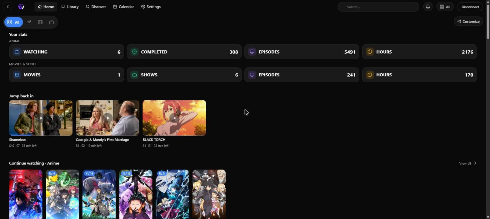
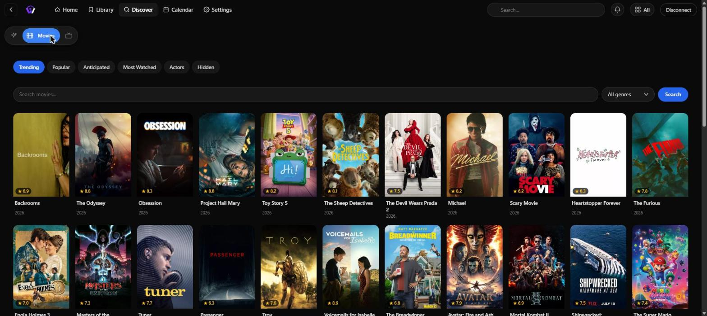
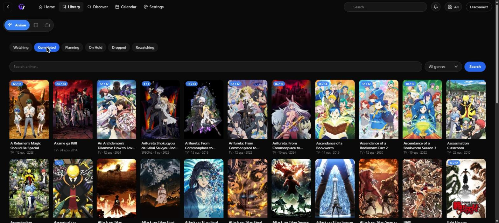
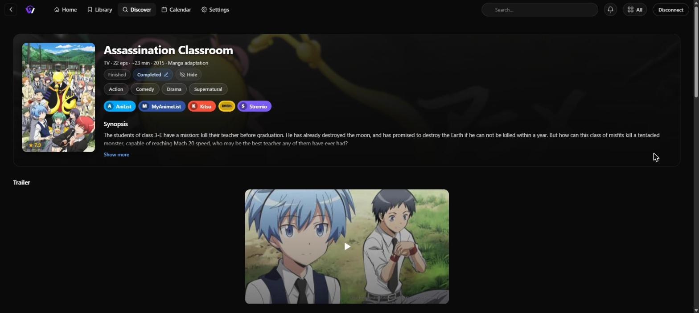
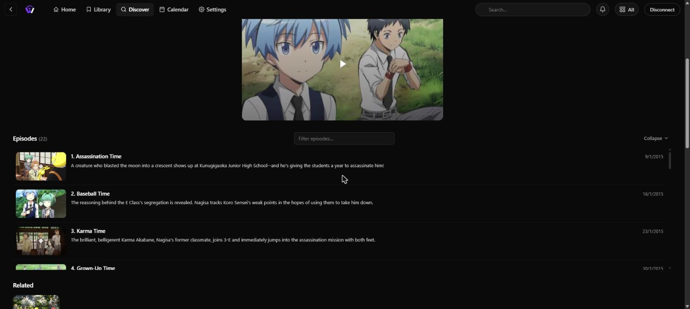
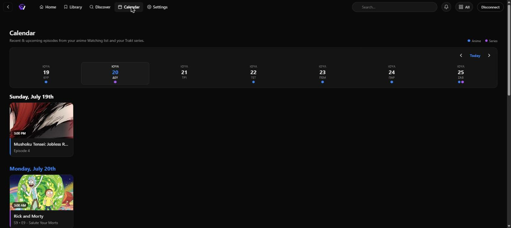

<!-- Drop a logo/banner here once you have one: assets/banner.png -->
<!--  -->

# Watchario

### Track everything you watch — **anime, movies & series** — kept in lockstep across **AniList**, **MyAnimeList**, **Kitsu** & **Trakt**, and watchable anywhere.

One account. Every tracker. On the web, on your phone, on your TV, in Stremio, and in your browser — update your progress once and it lands everywhere.

[Why Watchario](#why-watchario) · [What you can do](#what-you-can-do) · [Where it runs](#where-it-runs) · [What works where](#what-works-where) · [Get Watchario](#get-watchario) · [Data & API](#open-data--api) · [FAQ](#faq)

  

---

## Why Watchario

If you track what you watch, you've lived this:

> An episode ends. You open a tab, find AniList, update progress. Then you remember your friends are on MyAnimeList, so you do it again there. Three episodes later you give up — and your lists rot for six months.

Watchario fixes it with one promise:

> **Update once, everywhere. Watch anywhere, tracked automatically.**

Link the services you already use — AniList, MyAnimeList, Kitsu, Trakt (or just use a built-in Watchario account) — pick one as your source of truth, and every change fans out to the rest. Watch on the Watchario web app, on a native app, or through Stremio, and your progress follows you.

<!-- A short loop of a sync fan-out is the single best thing to show here. -->
<!--  -->

---

## What you can do

### 🔁 Lockstep multi-service sync — the headline
Link **AniList, MyAnimeList, Kitsu, and Trakt** to one account. Every progress / score / status change writes to your **primary** service and mirrors concurrently to every linked secondary, with scores and statuses translated to each service's own scale. Promote any account to primary with a click, one-shot-backfill your whole library onto a newly linked service, and get a clear **"needs re-auth"** flag instead of silent drift when a token expires. No external tracker? Create a **native Watchario account** and keep your whole library on Watchario itself.

### 🧭 Browse & discover — anime, movies & series
A single client for all three. Flip the media-type switch and Discover fills with what's **trending, seasonal, and airing**; browse by tag, studio, or staff; search everything. Your **Library** has status tabs (Watching / Completed / Planning / Paused / Dropped / Rewatching), title search, genre filter, and infinite scroll. Rich detail pages carry posters, scores, episode lists with thumbnails, recommendations, related entries, and deep-links to the same title on every service.

  
  

### ▶️ Watch, with your own streams
An integrated player on web and native, for anime, movies, and series alike. Bring your own streams through the **Stremio addon protocol** — Torrentio, MediaFusion, Comet, Jackettio, AIOStreams all work, with a quick-setup that builds and validates the URLs from a single debrid API key. **Subtitles** come merged and de-duplicated from OpenSubtitles + Wyzie. On anime, community **AniSkip** markers auto-skip openings, endings, and recaps.

  
  

### 📺 Great on a TV
A dedicated leanback layout with **D-pad navigation**, and **QR-code device pairing** so you never type a password with a remote. Android builds ship a combined arm64 + arm APK so budget Google TV boxes work too, with a hardware-accelerated ExoPlayer path (HDR tone-mapping included).

### 🗓️ Calendar & 🔔 notifications
A **weekly calendar** of upcoming and recent episodes for the anime and series you track. Release notifications fire the moment an episode airs — including a *"the show you planned just started airing"* heads-up — delivered in-app and as real **Web Push** (works with the tab closed, and on your phone home screen as a PWA).

  

### 🧩 Auto-track from where you already watch *(anime)*
- **Browser extension** (Chrome / Edge / Brave / Firefox): auto-updates your list as you watch on Crunchyroll, HiAnime/Zoro, and Aniwave — plus an opt-in "track this site" fallback for anywhere else.
- **Home-server scrobbling**: point a **Plex / Jellyfin / Emby** webhook at Watchario and finished episodes scrobble onto your linked trackers automatically.

### 🧬 Anime superpowers
Because it started life as an anime tracker, Watchario does things generic trackers don't: **canon / filler tagging**, **cour-aware episode numbering** and **franchise-season grouping** (so a split-cour show numbers correctly and a multi-season franchise collapses into one entry), and cross-referenced IDs across **seven namespaces** (AniList / Kitsu / MAL / IMDb / TMDB / TheTVDB / AniDB).

### 🔌 A public API
Every feature the app uses is exposed behind a Swagger-documented JSON API. The browser extension is built entirely on it — your own dashboard or scrobble script can be too. Docs live at **[/api/docs](https://watchario.app/api/docs)**.

---

## Where it runs

| Surface | What it is | Media types |
|---|---|:--|
| **Web app / PWA** | The full client at **[watchario.app](https://watchario.app)** — browse, watch, track, installable to your home screen. | anime · movies · series |
| **Native apps** | Android, Android TV / Google TV, iOS, Windows, macOS — the same UI, plus native video engines and OS-level notifications. | anime · movies · series |
| **Public REST API** | `/api/v1`, [Swagger docs](https://watchario.app/api/docs). Build your own client on it. | anime · movies · series |
| **Stremio addon** | Adds your anime catalogs, in-Stremio entry editing, per-episode metadata, and AniSkip hints. | anime |
| **Browser extension** | Auto-tracks anime as you watch on supported sites. | anime |

---

## What works where

Watchario is genuinely multi-media, but a few features are anime-specific by nature (a movie has no episodes to skip or slice). Here's the honest breakdown:

| Capability | Anime | Movies | Series |
|---|:---:|:---:|:---:|
| Track & multi-service sync | ✅ | ✅ | ✅ |
| Browse / Discover / Library | ✅ | ✅ | ✅ |
| Watch (player · streams · subtitles) | ✅ | ✅ | ✅ |
| Native apps (5 platforms) | ✅ | ✅ | ✅ |
| Public REST API | ✅ | ✅ | ✅ |
| Weekly calendar | ✅ | — | ✅ |
| Release notifications | ✅ | — | ✅ |
| AniSkip OP/ED/recap skip | ✅ | — | — |
| Canon / filler tags | ✅ | — | — |
| Cour slicing & franchise grouping | ✅ | — | — |
| Stremio addon catalogs | ✅ | — | — |
| Browser-extension auto-track | ✅ | — | — |
| Home-server scrobbling | ✅ | — | — |

> Which services back which media type: **anime** syncs across AniList, MyAnimeList, and Kitsu (and can also live on Trakt or a native Watchario account); **movies & series** are tracked via **Trakt**.

---

## Get Watchario

### 🌐 Web app
Open **[watchario.app](https://watchario.app)**, sign in (or skip auth for public browsing), and you're done. On mobile, tap the install icon in the address bar to add it as a PWA.

### 🤖 Android / Android TV
Download the latest APK and sideload it:

**[⬇️ Download watchario.apk](https://github.com/ttsiligkoudis/watchario-app/releases/download/android-latest/watchario.apk)**

> If Android warns about a signature conflict on update, uninstall the previous build first. Every release is signed with the same key, so normal updates install in place.

### 🎬 Stremio addon
1. Open **[watchario.app](https://watchario.app)**.
2. Sign in with AniList, MyAnimeList, or Kitsu (or use the public catalogs).
3. Toggle the catalogs you want, then click **Install to Stremio**.

### 🧩 Browser extension
Load it in your browser (Chrome/Edge/Brave: Developer mode → *Load unpacked*; Firefox: *Load Temporary Add-on*), then paste your Config UID from the app. It then auto-tracks anime as you watch on supported sites.

---

## Open data & API

We maintain the cross-service **ID-mapping data** that powers "one title, tracked everywhere," and publish it here for anyone to use — anime IDs mapped across AniList, Kitsu, MyAnimeList, IMDb, TMDB, TheTVDB, and AniDB, refreshed automatically.

➡️ **[Download the mapping data & format docs](docs/mapping-data.md)**

The full app API (search, match, media metadata, streams, subtitles, sync, notifications) is documented interactively at **[watchario.app/api/docs](https://watchario.app/api/docs)**.

---

## FAQ

<strong>Does Watchario stream video itself?</strong>

No — and that's deliberate. Watchario is the **tracker + player shell**: it manages your lists, metadata, and progress, and plays streams you bring via Stremio-protocol addons (Torrentio, Comet, and friends, typically with a debrid service). Trackers are durable; scraper addons come and go.

<strong>Do I need an AniList/MAL/Kitsu/Trakt account?</strong>

No. You can create a **native Watchario account** (email + password) and keep your entire library on Watchario, with no external service linked. Link external trackers whenever you want them kept in sync.

<strong>Is the sync two-way?</strong>

There's one **primary** service that's the source of truth; linked secondaries receive writes. Promote a different account to primary to flip the direction, and use the one-shot full-sync to backfill everything from primary to the rest.

<strong>Which media types get notifications and a calendar?</strong>

Anime and series (episode-based) get both a weekly calendar and release notifications. Movies are browse/track/watch only — there are no movie episodes to schedule.

<strong>Where is my data stored?</strong>

In a database on the Watchario server, keyed to your install. Provider tokens are stored only to keep your sync working, and nothing is shared with third parties.

---

**Questions, bugs, or feature requests? [Open an issue.](https://github.com/ttsiligkoudis/watchario-app/issues)**

Watchario · [watchario.app](https://watchario.app)

